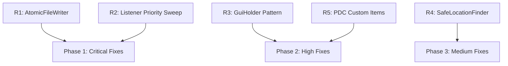

# SMPTools Consolidated Fix Plan (Production Ready)

| | |
|---|---|
| **Companion Docs** | `AUDIT_FINDINGS.md` (48 findings: 4 CRIT, 15 HIGH, 29 MED, 27 LOW), `FIX_PLAN.md` |
| **Target Tree** | `Berni04/SMPTools` (Paper 1.21.x / Java 17) |
| **Status** | Approved & Consolidated (Incorporates all 8 architectural corrections) |
| **Execution Strategy** | Phase 0 (Shared Utils) $\rightarrow$ Phase 1 (CRIT) $\rightarrow$ Phase 2 (HIGH) $\rightarrow$ Phase 3 (MED) $\rightarrow$ Phase 4 (LOW) |

---

## 1. Key Architectural Refinements over Previous Fix Plan

Before executing the detailed steps, the following 8 critical refinements have been baked into this plan to eliminate vulnerabilities and bugs present in previous drafts:

1. **Lock Pairing Protection ([`F-CRIT-01`](#f-crit-01--pure-canonical-keys--blockplace-pairing-protection)):**
   - *Previous draft flaw:* Auto-deleted stale single-chest locks on pairing, allowing an attacker to unlock a victim's chest simply by placing an adjacent chest.
   - *Final fix:* Intercept `BlockPlaceEvent`. If a chest is placed adjacent to another player's locked chest, **cancel the event**. If placed by the lock owner, extend the lock to the double chest cleanly. Never auto-delete existing locks.
2. **SSRF Connection Handling ([`F-CRIT-04`](#f-crit-04--ssrf-dns-pinning--range-expansion)):**
   - *Previous draft flaw:* Suggested `new Proxy(Proxy.Type.HTTP, ...)` on HTTPS connections, which sends `CONNECT` requests directly to origin web servers, failing on standard HTTPS endpoints.
   - *Final fix:* Use Java 11+ `java.net.http.HttpClient` with a custom address resolver or custom `SSLSocketFactory` resolving against pinned, validated IP addresses.
3. **Event Listener Priority Discipline ([`R2`](#r2--listener-priority--cancellation-sweep)):**
   - *Previous draft contradiction:* Suggested mutating chunk loaders and dropping items at `MONITOR` priority.
   - *Final fix:* State mutations and item drops strictly execute at `HIGHEST` (or `HIGH`) with `ignoreCancelled = true`. `MONITOR` is strictly reserved for read-only scoring and logging.
4. **GUI Inventory Scope ([`R3`](#r3--guiholder-inventoryholder-pattern)):**
   - *Previous draft flaw:* Applied top-inventory-only click guards globally across all menus.
   - *Final fix:* Distinguish between **Display/Action GUIs** (Advent, Troll, Stats, Hubs), which enforce top-inventory-only clicks, and **Transfer GUIs** (Trade, Bounty Deposit, Artifact Pouch), which permit controlled interactions with the bottom player inventory.
5. **Safe Location Calculation ([`R4`](#r4--safelocationfinder-utility)):**
   - *Previous draft flaw:* Recursive call on fallback spawn location caused `StackOverflowError` if spawn was unsafe, and discarded player pitch/yaw.
   - *Final fix:* Return `Optional<Location>`, check hazard blocks (lava, fire, sweet berries, powder snow), preserve player facing direction (pitch/yaw), and fail gracefully with user feedback.
6. **Lazy Black Friday Trade Restoration ([`F-HIGH-12`](#f-high-12--black-friday-discount-persistence--lazy-restore)):**
   - *Previous draft flaw:* Tried restoring all villager trades during `onEnable()`, returning null for unloaded entities in inactive chunks.
   - *Final fix:* Hook `InventoryOpenEvent` and `ChunkLoadEvent` to restore original villager trades on the fly whenever a discounted villager is accessed or loaded outside active event windows.
7. **Complete Grave Physical Protection ([`F-HIGH-03/04`](#f-high-0304--grave-lifecycle--tamper-proofing)):**
   - *Previous draft gap:* Missed piston movement and liquid destruction.
   - *Final fix:* Add `BlockPistonExtendEvent`, `BlockPistonRetractEvent`, and `BlockFromToEvent` listeners to prevent graves from being pushed by pistons or washed away by water/lava.
8. **Native MiniMessage Sanitization ([`F-HIGH-10`](#f-high-10--rename-sanitization--permission-gating)):**
   - *Previous draft gap:* Relied on custom regex string stripping.
   - *Final fix:* Use Kyori Adventure's native `StandardTags` resolver to filter out `<click>`, `<hover>`, `<insert>`, and `<font>` tags safely at the AST level.

---

## 2. Phase 0 — Cross-Cutting Refactors (Do First)



### R1 — `AtomicFileWriter` Utility
- **Solves:** MED-01; hardens MED-04, MED-29, HIGH-05, HIGH-12 persistence paths.
- **File:** `src/main/java/com/smp/smptools/utils/AtomicFileWriter.java`
- **Implementation:**
  ```java
  public final class AtomicFileWriter {
      public static void write(Path target, byte[] data) throws IOException {
          Path parent = target.getParent();
          if (parent != null) {
              Files.createDirectories(parent);
          }
          Path tmp = parent != null 
                  ? parent.resolve(target.getFileName() + "." + UUID.randomUUID() + ".tmp")
                  : Files.createTempFile("smptools-", ".tmp");
          
          Files.write(tmp, data, StandardOpenOption.CREATE, StandardOpenOption.TRUNCATE_EXISTING,
                  StandardOpenOption.WRITE, StandardOpenOption.SYNC);
          try {
              Files.move(tmp, target, StandardCopyOption.ATOMIC_MOVE, StandardCopyOption.REPLACE_EXISTING);
          } catch (AtomicMoveNotSupportedException e) {
              Files.move(tmp, target, StandardCopyOption.REPLACE_EXISTING);
          } finally {
              Files.deleteIfExists(tmp);
          }
      }

      public static void save(FileConfiguration cfg, File file) throws IOException {
          write(file.toPath(), cfg.saveToString().getBytes(StandardCharsets.UTF_8));
      }
  }
  ```
- **Call Sites:** `AsyncConfigHelper.java`, `BountyManager.java`, `MissionManager.java`, `SeasonalManager.java`, `VaultListener.java`, `GraveManager.java`, `LockManager.java`, `ChunkLoaderManager.java`.

### R2 — Listener Priority & Cancellation Sweep
- **Solves:** HIGH-01, HIGH-06, MED-11, MED-18.
- **Rule:**
  - **State Mutations & Drops:** `@EventHandler(priority = EventPriority.HIGH / HIGHEST, ignoreCancelled = true)`
  - **Read-Only / Logging / Analytics:** `@EventHandler(priority = EventPriority.MONITOR, ignoreCancelled = true)`
  - Never mutate state or drop items at `MONITOR`.

### R3 — `GuiHolder` (`InventoryHolder`) Pattern
- **Solves:** MED-09, LOW-20, HIGH-15; prevents title-spoofing across all menus.
- **File:** `src/main/java/com/smp/smptools/gui/GuiHolder.java`
- **Specification:**
  ```java
  public final class GuiHolder implements InventoryHolder {
      public enum MenuType { 
          TRADE(false), BOUNTY_LIST(true), BOUNTY_DETAILS(true), BOUNTY_CLAIM(true), 
          BOUNTY_DEPOSIT(false), ADVENT(true), TROLL(true), ARTIFACT_POUCH(false), 
          HALLOWEEN(true), EASTER(true), SEASONAL_HUB(true), EVENT_DASH(true),
          STATS(true), LEADERBOARD(true), MISSION(true);

          private final boolean topOnlyClicks;
          MenuType(boolean topOnlyClicks) { this.topOnlyClicks = topOnlyClicks; }
          public boolean isTopOnly() { return topOnlyClicks; }
      }

      private final MenuType type;
      private final UUID viewer;
      private Inventory inventory;

      public GuiHolder(MenuType type, UUID viewer) {
          this.type = type;
          this.viewer = viewer;
      }
      @Override public Inventory getInventory() { return inventory; }
      public void setInventory(Inventory inv) { this.inventory = inv; }
      public MenuType getType() { return type; }
      public UUID getViewer() { return viewer; }
  }
  ```

### R4 — `SafeLocationFinder` Utility
- **Solves:** MED-14, MED-16.
- **File:** `src/main/java/com/smp/smptools/teleport/SafeLocationFinder.java`
- **Specification:**
  - Searches vertically `[y, y+1, y-1, y+2, y-2, y+3]` within world min/max height.
  - Validates `feet` and `head` are passable and not hazardous (`!isSolid()`, `!isLiquid()`, not fire/powder snow/berries/wither rose).
  - Validates `ground` is solid and safe (`ground.getType().isSolid()`, not magma/cactus).
  - Validates world border containment.
  - Preserves original location yaw and pitch.
  - Returns `Optional<Location>` without recursive fallback loops.

### R5 — PDC-Only Custom Item Identification
- **Solves:** LOW-12, LOW-21, LOW-23.
- **Rule:** Tag custom items at creation using `NamespacedKey(plugin, "<key>")` stored in `item.getItemMeta().getPersistentDataContainer()`. Listener checks evaluate PDC tags only, completely eliminating display name/lore equality fallback vulnerabilities.

---

## 3. Phase 1 — CRITICAL Fixes

### F-CRIT-01 — Pure Canonical Keys & `BlockPlace` Pairing Protection
- **Finding:** CRIT-01 (Lock migration on read path transfers ownership to attacker).
- **Files:** [`LockManager.java:120-168`](file:///Users/bernatfortuny/Documents/code/smptools/src/main/java/com/smp/smptools/locks/LockManager.java#L120-L168), [`LockListener.java`](file:///Users/bernatfortuny/Documents/code/smptools/src/main/java/com/smp/smptools/listeners/LockListener.java)
- **Changes:**
  1. Make `getBlockKey(Block block)` a **pure function**: compute the canonical lower-coordinate half without modifying `containerOwners` or calling `saveLocks()`.
  2. Add `BlockPlaceEvent` handler in `LockListener`:
     ```java
     @EventHandler(priority = EventPriority.HIGH, ignoreCancelled = true)
     public void onChestPlace(BlockPlaceEvent event) {
         Block placed = event.getBlockPlaced();
         if (!(placed.getState() instanceof Chest chest)) return;
         
         for (BlockFace face : new BlockFace[]{BlockFace.NORTH, BlockFace.EAST, BlockFace.SOUTH, BlockFace.WEST}) {
             Block relative = placed.getRelative(face);
             if (relative.getState() instanceof Chest relativeChest) {
                 if (lockManager.isLocked(relative)) {
                     UUID owner = lockManager.getOwnerUUID(relative);
                     if (!event.getPlayer().getUniqueId().equals(owner) && !event.getPlayer().hasPermission("smptools.locks.admin")) {
                         event.setCancelled(true);
                         event.getPlayer().sendMessage(MiniMessage.miniMessage().deserialize("<red>🔒 You cannot place a chest adjacent to someone else's locked chest!</red>"));
                         return;
                     }
                 }
             }
         }
     }
     ```
  3. When an owner places a chest adjacent to their own locked single chest, migrate the single key to the double canonical key safely.

### F-CRIT-02 — Ownership Guard in `lockContainer` & Break Own Half Rule
- **Finding:** CRIT-02 (Unchecked lock container command).
- **Files:** [`LockManager.java:272-280`](file:///Users/bernatfortuny/Documents/code/smptools/src/main/java/com/smp/smptools/locks/LockManager.java#L272-L280), [`LockCommand.java:59-63`](file:///Users/bernatfortuny/Documents/code/smptools/src/main/java/com/smp/smptools/commands/LockCommand.java#L59-L63), [`LockListener.java:50-62`](file:///Users/bernatfortuny/Documents/code/smptools/src/main/java/com/smp/smptools/listeners/LockListener.java#L50-L62)
- **Changes:**
  1. In `LockManager.lockContainer(Block, Player)`: check if the canonical key is already locked by another player; reject if not owner and lacks `smptools.locks.admin`.
  2. In `LockListener.onBlockBreak`: allow breaking a chest half if the breaker is the recorded owner of either half-key.

### F-CRIT-03 — Image Dimension Pre-Check Before Decode
- **Finding:** CRIT-03 (Decompression bomb OOM via `/tomap`).
- **Files:** [`ImageProcessor.java:17-29`](file:///Users/bernatfortuny/Documents/code/smptools/src/main/java/com/smp/smptools/imagemap/ImageProcessor.java#L17-L29), [`Constants.java`](file:///Users/bernatfortuny/Documents/code/smptools/src/main/java/com/smp/smptools/utils/Constants.java)
- **Changes:**
  - Before allocating image memory, inspect headers using `ImageReader`:
    ```java
    private static final int MAX_DIMENSION = 4096;
    private static final long MAX_PIXELS = 4096L * 4096L;

    public static BufferedImage getImage(InputStream inputStream, int width, int height) {
        try (ImageInputStream iin = ImageIO.createImageInputStream(inputStream)) {
            if (iin == null) return null;
            Iterator<ImageReader> readers = ImageIO.getImageReaders(iin);
            if (!readers.hasNext()) return null;
            ImageReader reader = readers.next();
            try {
                reader.setInput(iin, true, true);
                int pw = reader.getWidth(0);
                int ph = reader.getHeight(0);
                if (pw <= 0 || ph <= 0 || pw > MAX_DIMENSION || ph > MAX_DIMENSION || ((long) pw * ph) > MAX_PIXELS) {
                    logger.warning("Image dimensions exceeded limits (" + pw + "x" + ph + ")");
                    return null;
                }
                BufferedImage downloaded = reader.read(0);
                if (downloaded == null) return null;
                return ditherImage(resizeImage(downloaded, width, height));
            } finally {
                reader.dispose();
            }
        } catch (Exception e) {
            logger.log(Level.SEVERE, "Failed to process image", e);
            return null;
        }
    }
    ```

### F-CRIT-04 — SSRF: DNS Pinning & Range Expansion
- **Finding:** CRIT-04 (DNS-rebinding TOCTOU & missing IPv6/CGNAT ranges).
- **Files:** [`URLValidator.java`](file:///Users/bernatfortuny/Documents/code/smptools/src/main/java/com/smp/smptools/utils/URLValidator.java), [`MapCommand.java`](file:///Users/bernatfortuny/Documents/code/smptools/src/main/java/com/smp/smptools/imagemap/MapCommand.java), [`MusicCommand.java`](file:///Users/bernatfortuny/Documents/code/smptools/src/main/java/com/smp/smptools/commands/MusicCommand.java)
- **Changes:**
  1. Expand `isPrivateOrBlockedIp(InetAddress address)` to explicitly reject:
     - `fc00::/7` (IPv6 ULA)
     - `100.64.0.0/10` (CGNAT)
     - `198.18.0.0/15` (Network Benchmark)
     - `192.0.0.0/24`, `0.0.0.0/8`, `240.0.0.0/4`
     - Multicast (`isMulticastAddress()`)
     - Loopback, LinkLocal, SiteLocal/RFC1918.
  2. Implement DNS pinning via `java.net.http.HttpClient` (Java 17 built-in) or a pinned `SocketFactory` that resolves once, checks all resolved addresses, and pins the connection.
  3. Perform validation and HTTP requests completely inside background async tasks (resolves MED-05 simultaneously).

---

## 4. Phase 2 — HIGH Fixes

### F-HIGH-01/02 — Trade Listener Hardening & Settling State Machine
- **Files:** [`TradeListener.java:32,145`](file:///Users/bernatfortuny/Documents/code/smptools/src/main/java/com/smp/smptools/listeners/TradeListener.java#L32-L145), [`TradeSession.java:185-212`](file:///Users/bernatfortuny/Documents/code/smptools/src/main/java/com/smp/smptools/trade/TradeSession.java#L185-L212)
- **Changes:**
  1. Add `ignoreCancelled = true` on `onInventoryClick` and `onInventoryDrag`.
  2. Introduce `TradeSession.State { ACTIVE, SETTLING, COMPLETED, CANCELLED }`.
  3. When trade completes/cancels, synchronously blank decoration items (barriers/panes) to `null` and set state to `SETTLING`.
  4. In `TradeListener`: if session is `SETTLING` or not found on trade inventory, cancel the click unconditionally.

### F-HIGH-03/04 — Grave Lifecycle & Tamper-Proofing
- **Files:** [`GraveManager.java`](file:///Users/bernatfortuny/Documents/code/smptools/src/main/java/com/smp/smptools/graves/GraveManager.java)
- **Changes:**
  1. Add `@EventHandler(priority = EventPriority.HIGH, ignoreCancelled = true) onBlockBreak(BlockBreakEvent)`:
     - If location is a grave, only owner or admin can break (pops items onto ground and removes holograms). Non-owners are denied.
  2. Protect graves from `BlockExplodeEvent`, `EntityExplodeEvent`, `BlockPistonExtendEvent`, `BlockPistonRetractEvent`, and `BlockFromToEvent` (liquid flow).
  3. Stamp placed skull block entity with PDC `NamespacedKey(plugin, "grave_owner") = uuid`.
  4. On death collision: scan vertically for the nearest unoccupied air block rather than overwriting an existing grave.
  5. Add grave expiry configuration (`features.player-graves.expire-hours`, default 72h) with periodic cleanup dropping items at the grave spot.

### F-HIGH-05 — Private Vault Serialization Safety
- **Files:** [`PrivateVaultCommand.java:42-76`](file:///Users/bernatfortuny/Documents/code/smptools/src/main/java/com/smp/smptools/commands/PrivateVaultCommand.java#L42-L76), [`VaultListener.java:31-35`](file:///Users/bernatfortuny/Documents/code/smptools/src/main/java/com/smp/smptools/listeners/VaultListener.java#L31-L35)
- **Changes:**
  1. Bound `readInt()` to `[0, MAX_VAULT_SIZE * 4]`.
  2. If deserialization fails, set transient flag `vaultDecodeFailed` on the player and open an error view.
  3. In `VaultListener.onInventoryClose`: if `vaultDecodeFailed` is true, **abort save**, preserve existing disk blob, and alert admins.
  4. Migrate vaults to isolated `vaults.yml` saved via `AtomicFileWriter`.

### F-HIGH-06/07 — Chunk Loader Caps & Lifecycle
- **Files:** [`ChunkLoaderListener.java:24-54`](file:///Users/bernatfortuny/Documents/code/smptools/src/main/java/com/smp/smptools/listeners/ChunkLoaderListener.java#L24-L54), [`ChunkLoaderManager.java`](file:///Users/bernatfortuny/Documents/code/smptools/src/main/java/com/smp/smptools/chunkloaders/ChunkLoaderManager.java)
- **Changes:**
  1. Add `ignoreCancelled = true` and `priority = EventPriority.HIGH` to place/break handlers.
  2. Store `ChunkLoaderRecord { Location, UUID owner, long placedAt }`.
  3. Enforce caps: `features.chunk-loaders.max-per-player` (default 8), `max-global` (default 128).
  4. Handle `BlockExplodeEvent`, `EntityExplodeEvent`, and `EntityChangeBlockEvent` (wither) to unforce chunks when destroyed.
  5. Check ownership on break: only owner or admin may dismantle a loader.

### F-HIGH-08 — Christmas Gamemode Save/Restore & Void Fall Rescue
- **Files:** [`ChristmasWorldListener.java:40-66`](file:///Users/bernatfortuny/Documents/code/smptools/src/main/java/com/smp/smptools/listeners/ChristmasWorldListener.java#L40-L66)
- **Changes:**
  1. On world change into `christmas`: store previous `GameMode` in player PDC (`orig_gamemode`) and switch to `ADVENTURE` (unless Creative/Spectator).
  2. On world change out of `christmas`, player quit, or respawn: read PDC and restore original `GameMode`.
  3. Exempt `DamageCause.VOID` from damage cancellation; schedule periodic check teleporting players falling below `minHeight` back to world spawn.

### F-HIGH-09 — Krampus Guard Liveness Tracking
- **Files:** [`KrampusListener.java:100-109`](file:///Users/bernatfortuny/Documents/code/smptools/src/main/java/com/smp/smptools/listeners/KrampusListener.java#L100-L109), [`KrampusManager.java:292-305`](file:///Users/bernatfortuny/Documents/code/smptools/src/main/java/com/smp/smptools/christmas/KrampusManager.java#L292-L305)
- **Changes:**
  1. Trigger `checkGuardDeath` on `EntityDeathEvent` regardless of killer identity (`/kill`, fire, other players).
  2. Add watchdog task checking live guard counts every 10s: if all guards are dead/cleared, automatically release the caged victim.

### F-HIGH-10 — `/rename` Sanitization & Permission Gating
- **Files:** [`RenameCommand.java:41-45`](file:///Users/bernatfortuny/Documents/code/smptools/src/main/java/com/smp/smptools/commands/RenameCommand.java#L41-L45), [`plugin.yml:63-65`](file:///Users/bernatfortuny/Documents/code/smptools/src/main/resources/plugin.yml#L63-L65)
- **Changes:**
  1. Add `permission: smptools.rename` to `plugin.yml`.
  2. Cap input length to 64 characters.
  3. Sanitize using Kyori Adventure's native `StandardTags`:
     ```java
     private static final MiniMessage SAFE_MINI_MESSAGE = MiniMessage.builder()
         .tags(TagResolver.builder()
             .resolver(StandardTags.color())
             .resolver(StandardTags.decorations())
             .resolver(StandardTags.gradient())
             .resolver(StandardTags.rainbow())
             .build())
         .build();
     ```

### F-HIGH-11 — `/sudo` Command Allowlist & Target Protection
- **Files:** [`SudoCommand.java:42-52`](file:///Users/bernatfortuny/Documents/code/smptools/src/main/java/com/smp/smptools/commands/SudoCommand.java#L42-L52), [`CommandBlacklist.java`](file:///Users/bernatfortuny/Documents/code/smptools/src/main/java/com/smp/smptools/utils/CommandBlacklist.java), [`plugin.yml:109-111`](file:///Users/bernatfortuny/Documents/code/smptools/src/main/resources/plugin.yml#L109-L111)
- **Changes:**
  1. Replace blacklist with configurable allowlist `sudo.allowed-command-prefixes: ["msg", "tell", "w", "me", "help"]`.
  2. Require `--confirm` flag if the target has OP or `smptools.sudo` permissions.
  3. Declare `permission: smptools.sudo` in `plugin.yml`.

### F-HIGH-12 — Black Friday Discount Persistence & Lazy Restore
- **Files:** [`BlackFridayListener.java:26,56-64`](file:///Users/bernatfortuny/Documents/code/smptools/src/main/java/com/smp/smptools/listeners/BlackFridayListener.java#L26-L64)
- **Changes:**
  1. Persist original recipes to `blackfriday_state.yml` using `AtomicFileWriter`.
  2. Hook `InventoryOpenEvent` and `ChunkLoadEvent`: if a villager UUID is in `blackfriday_state.yml` and Black Friday is inactive, restore original recipes on the fly.
  3. Clean up state file on complete restoration.

### F-HIGH-13 — DialogueManager Entity & Memory Cleanup
- **Files:** [`DialogueManager.java:126-142`](file:///Users/bernatfortuny/Documents/code/smptools/src/main/java/com/smp/smptools/managers/DialogueManager.java#L126-L142)
- **Changes:**
  1. In watchdog timer: remove `TextDisplay` entity before cancelling if the player is offline.
  2. Register `PlayerQuitEvent` listener calling `stopDialogue(player)` to clear maps and despawn entities.

### F-HIGH-14 — Confine FlatFile Storage Access to Main Thread
- **Files:** [`TagManager.java:87-109`](file:///Users/bernatfortuny/Documents/code/smptools/src/main/java/com/smp/smptools/tags/TagManager.java#L87-L109), [`FlatFileStorageProvider.java:95-121`](file:///Users/bernatfortuny/Documents/code/smptools/src/main/java/com/smp/smptools/storage/FlatFileStorageProvider.java#L95-L121)
- **Changes:**
  - Route all `YamlConfiguration` read/set calls through the main thread using `callSyncMethod` or keep memory caches in `playerTitles` and save snapshots to disk atomically.

### F-HIGH-15 — Advent Calendar Top-Inventory Binding & PDC Day Stamping
- **Files:** [`AdventGUIListener.java:89-101`](file:///Users/bernatfortuny/Documents/code/smptools/src/main/java/com/smp/smptools/listeners/AdventGUIListener.java#L89-L101)
- **Changes:**
  1. Wrap with `GuiHolder(MenuType.ADVENT, player.getUniqueId())`.
  2. Enforce `event.getClickedInventory() == event.getView().getTopInventory()`.
  3. Derive day number from item PDC tag (`NamespacedKey(plugin, "advent_day")`) instead of raw slot math.

---

## 5. Phase 3 — MEDIUM Fixes Summary

* **MED-02:** Flip default `use-ssl: true` in `JdbcStorageProvider`.
* **MED-03:** Add pending-write cache for sync reads immediately following async DB writes.
* **MED-04:** Dedicated `vaults.yml` persistence path.
* **MED-05:** Move all URL validation off the main thread.
* **MED-06:** Clamp NBS notes to `[33, 57]` and wrap `SongPlayer.playNote` in try/catch with error threshold aborts.
* **MED-07:** Replace recursive `collectLogs` in `EnchantmentListener` with an iterative queue capped at 512.
* **MED-08:** Add permission nodes and 10s cooldowns to `/tomap` and `/music`.
* **MED-09:** Retrofit `TrollGUIListener` with `GuiHolder` and verify permissions on click.
* **MED-10:** Exempt `VOID` damage from cancel and teleport falling players back to spawn.
* **MED-11:** Delete MONITOR break listener in `LockListener`; mutate in HIGH handler.
* **MED-12:** Exclude `Material.ENDER_CHEST` from lockable container materials.
* **MED-13:** Protect locked blocks in `EntityChangeBlockEvent` against Withers.
* **MED-14:** Wire `SafeLocationFinder` into `/home`, `/tpa`, and `/tp`.
* **MED-15:** Cancel pending teleport warmup on `VehicleEnterEvent`.
* **MED-16:** Reject TPA requests if requester is dead; `PlayerDeathEvent` cancels warmups.
* **MED-17:** Isolate sleep vote calculation to initiator's world and disable AFK auto-yes by default.
* **MED-18:** Add `EquipmentSlot.HAND` and `ignoreCancelled = true` to `SitListener`.
* **MED-19:** Revoke plugin-granted flight on death or cross-world changes.
* **MED-20:** Sanitize NPC skin and ID names using regex `^[a-zA-Z0-9_-]+$`.
* **MED-21:** Fetch NPC skin profiles asynchronously.
* **MED-22:** Gate snowball warfare to christmas world, filter out pets/villagers, and limit headshot Y-band.
* **MED-23:** Reject `/secretsanta start` when deposited gifts exist without explicit `/secretsanta clear`.
* **MED-24:** Periodic Krampus kidnap validation, block chorus fruit/pearls while caged, and despawn orphaned cages.
* **MED-25:** Fire synthetic `BlockBreakEvent` per crop harvested with Nature's Touch Hoe.
* **MED-26:** Route failed online event reward commands to offline retry queue.
* **MED-27:** Track and restore replaced scoreboards cleanly on event end or player quit.
* **MED-28:** Add configuration option to filter/weight `SpawnReason.SPAWNER` in Mob Frenzy.
* **MED-29:** Synchronous atomic write on bounty claim with tombstone records.

---

## 6. Phase 4 — LOW Fixes Summary

| ID | Location | Solution |
|---|---|---|
| **LOW-01** | `AsyncConfigHelper.java` | Refuse saves once shutting down; drop class lock during `awaitTermination`. |
| **LOW-02** | `TrailManager.java`, `TagManager.java` | Add `.get(5, TimeUnit.SECONDS)` timeout on sync futures. |
| **LOW-03** | `TrailsGUIListener.java` | Check `Bukkit.getPlayer(uuid) != null` / avoid async Player entity reads. |
| **LOW-04** | `LeaderboardManager.java` | Add `volatile` to `lastCacheTime`. |
| **LOW-05** | `MongoStorageProvider.java` | Align `_` vs `$DOT$` key encoding with one-time migration. |
| **LOW-06** | `JoinLeaveListener.java` | Add save-on-quit for player stats behind `stats.save-on-quit: true`. |
| **LOW-07** | `CustomItemCommand.java` | Validate `material.isItem()` and `meta != null`. |
| **LOW-08** | `MapCommand.java` | Mask internal error strings from user; log details to console. |
| **LOW-09** | `MusicCommand.java` | Cancel active song tasks in `PlayerQuitEvent`. |
| **LOW-10** | `SoundCommand.java` | Add 5-second per-player cooldown. |
| **LOW-11** | `ChatManager.java`, `NameTagListener.java` | Pass `tagTitle` through `SAFE_MINI_MESSAGE`. |
| **LOW-12** | `ChunkLoaderManager.java` | Rely exclusively on PDC `NamespacedKey` tag. |
| **LOW-13** | `PortalListener.java` | Add block coordinate change check, resolve overworld by `Environment.NORMAL`. |
| **LOW-14** | `LockListener.java` | Permit owner passthrough for locked hoppers/dispensers or document behavior. |
| **LOW-15** | `LockManager.java` | Add 1.21 containers (`CRAFTER`, `LECTERN`, `DECORATED_POT`). |
| **LOW-16** | `CropAccelerator.java` | Add growth logic for cane/cactus/bamboo; distribute chunk scans across ticks. |
| **LOW-17** | `ChatManager.java` | Clear player from `lastMessengers` in `PlayerQuitEvent`. |
| **LOW-18** | `TpaManager.java` | Clear toggled-off on quit; key pending requests by `(target, requester)`. |
| **LOW-19** | `DailyRewardCommand.java` | Catch `DateTimeParseException` on corrupt dates and treat as unclaimed. |
| **LOW-20** | `AdventGUIListener.java` | Solved by `GuiHolder` (R3). |
| **LOW-21** | `FestiveMobsListener.java` | PlainTextSerializer for candy cane, hand check, PDC tag. |
| **LOW-22** | `FestiveMobsListener.java` | Limit festive hats to `SpawnReason.NATURAL` and overworld/christmas worlds. |
| **LOW-23** | `PresentListener.java` | Constrain present placement; preserve block if tier invalid. |
| **LOW-24** | `KrampusListener.java` | Demote hit log spam to `Level.FINE` or debug flag. |
| **LOW-25** | `SecretSantaManager.java` | Restrict registration to December unless config override is enabled. |
| **LOW-26** | `BountyGUIListener.java` | Add `+N more items` indicator when bounty exceeds 45 items. |
| **LOW-27** | `MiniEventSession.java` | Clean scoreboards in `PlayerQuitEvent`. |

---

## 7. Definition of Done & Rollout Verification

1. **Clean Compilation & Tests:** `mvn clean package` passes with zero compiler warnings or broken tests.
2. **Dynamic Verification:**
   - Chest pairing and adjacent placement cannot bypass locks or transfer ownership.
   - `/tomap` with large dimension images fails gracefully without memory spikes.
   - SSRF tests against `127.0.0.1`, `100.64.0.1`, `fc00::1`, and metadata endpoints are blocked.
   - Trade GUI click cancellation does not dupe items or leak decoration panes.
   - Graves survive explosions/pistons and loot properly.
   - Chunk loaders enforce caps and deregister on destruction.
   - Christmas world restores player gamemode on exit or relog.
